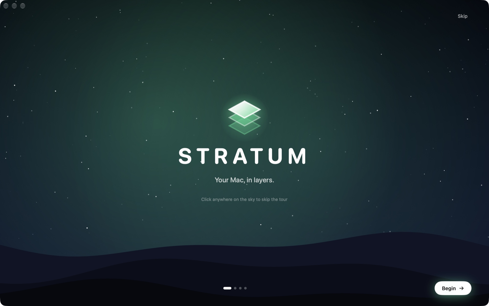
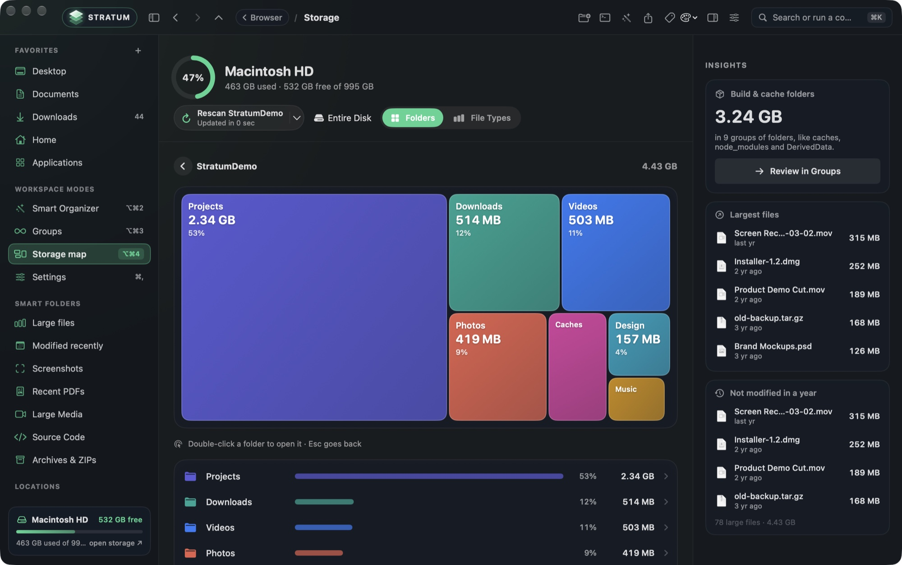
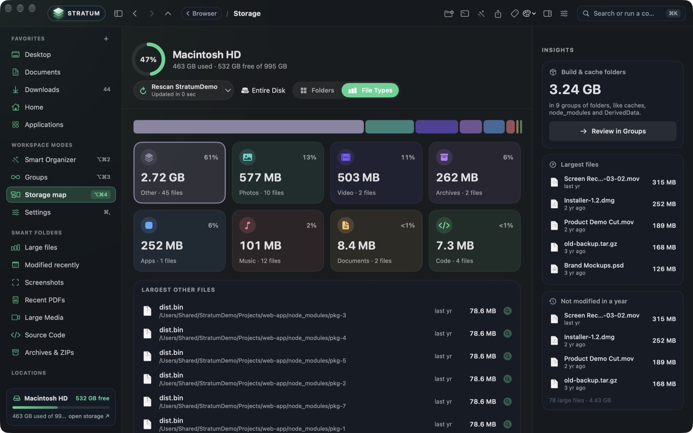
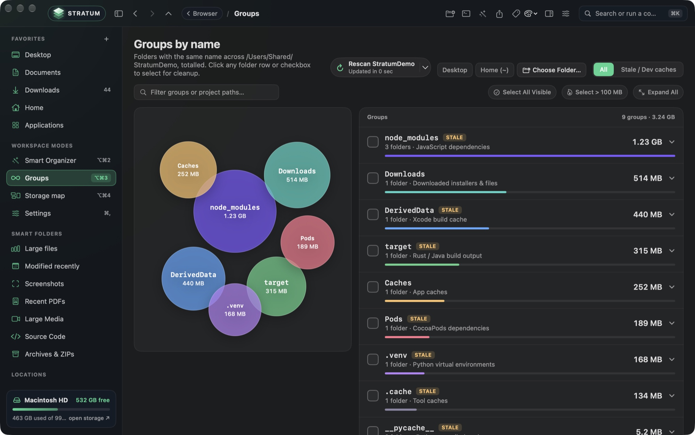
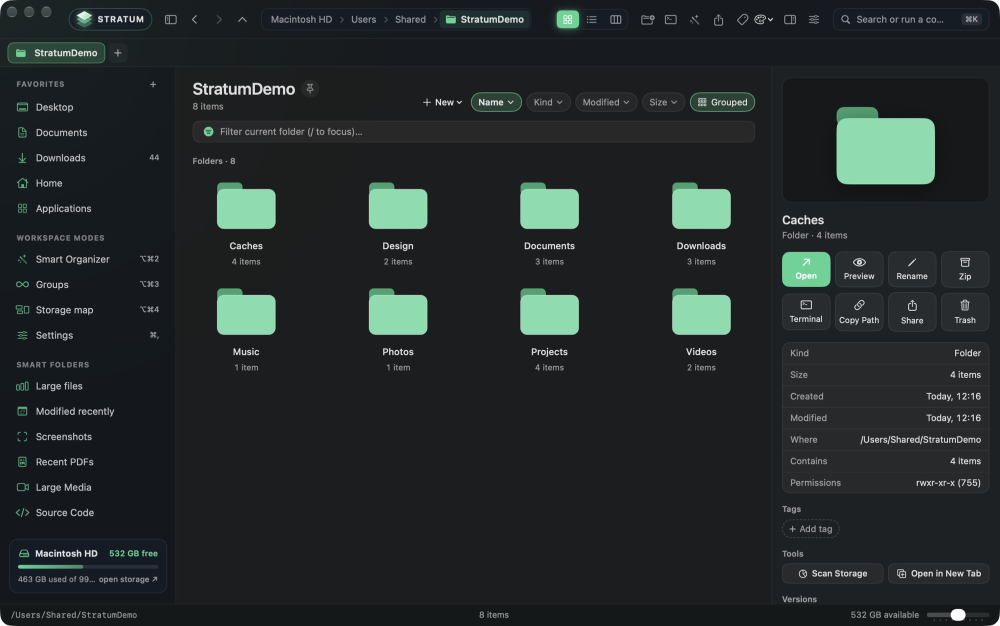
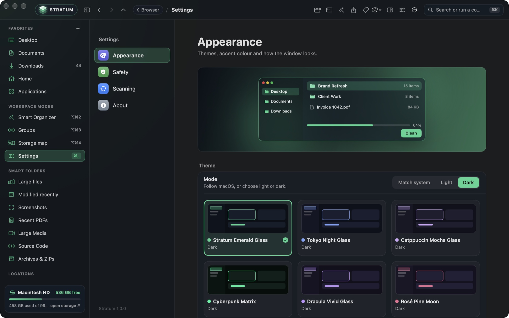
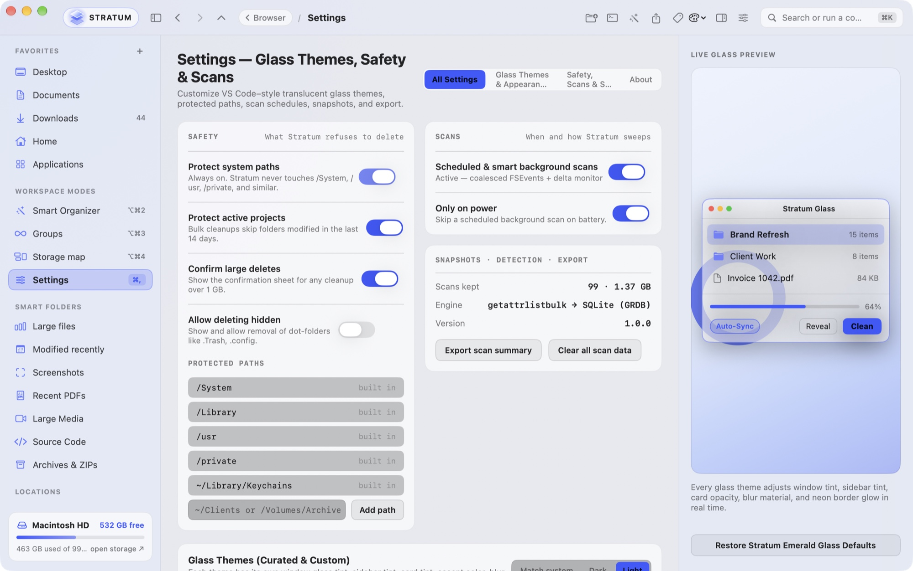
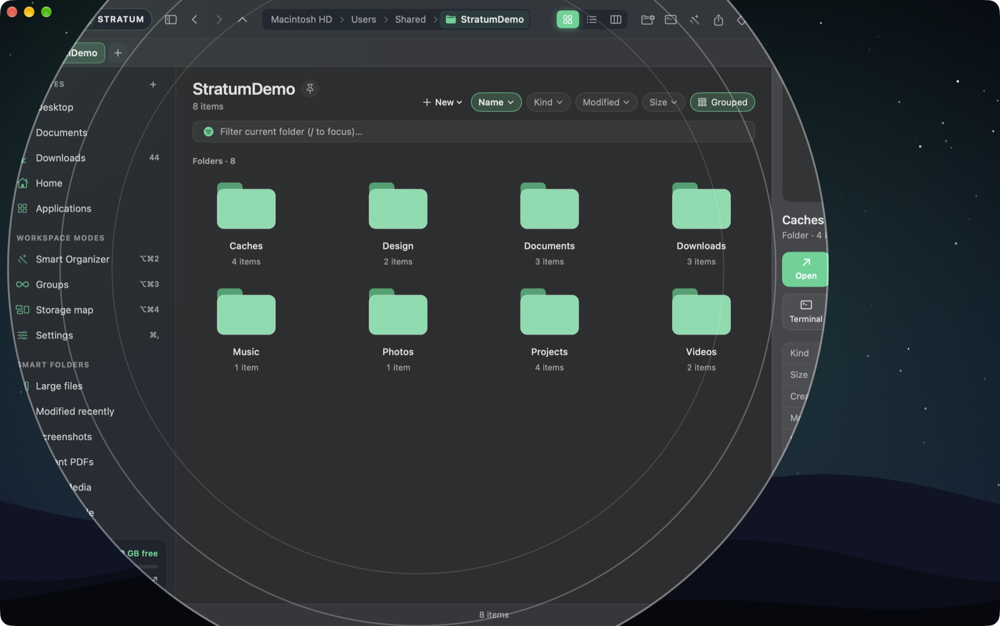
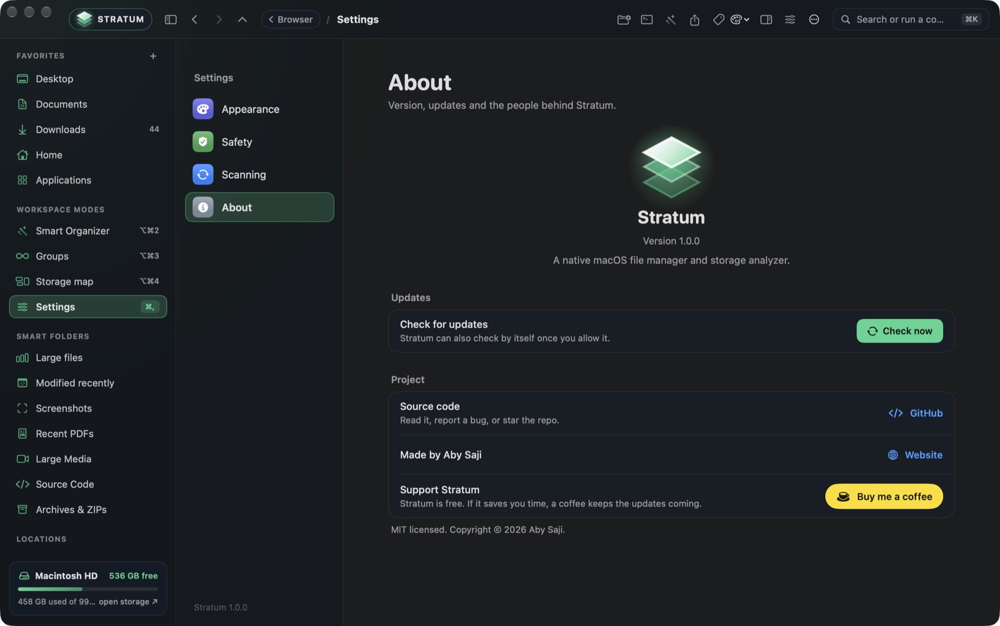

<p align="center">
  
</p>

<p align="center">
  <a href="https://github.com/AbyAbyss/stratum_file_manager/releases/latest"></a>
  
  
  
  <a href="https://buymeacoffee.com/abyabyss"></a>
</p>

<h3 align="center">Find what's eating your disk. <b>Then do something about it.</b></h3>

<p align="center">
  A native Mac file manager and storage analyzer: browse fast, see where the space went,<br>
  and clean up build caches and duplicates with an undo.
</p>

<p align="center">
  <a href="https://github.com/AbyAbyss/stratum_file_manager/releases/latest"><b>⬇&nbsp; Download for macOS</b></a> &nbsp;·&nbsp;
  <a href="#features">Features</a> &nbsp;·&nbsp;
  <a href="#keyboard-shortcuts">Shortcuts</a> &nbsp;·&nbsp;
  <a href="#build-from-source">Build</a> &nbsp;·&nbsp;
  <a href="#support-stratum">Support</a>
</p>

---

## See where the space went

The **Storage map** scans a folder or your whole disk once, then lets you explore it as a treemap.
Double-click a block to zoom into that folder, press <kbd>Esc</kbd> to zoom back out. Hover a block
and the matching row in the list lights up.

<p align="center">
  
</p>

The **Insights** panel on the right points at what's worth a look: how much is sitting in build and
cache folders, your largest files, and large files nobody has touched in a year. It never deletes
anything; cleanup lives in Groups, where there is a selection, a confirmation and an undo.

<table>
  <tr>
    <td width="54%" valign="middle">
      
    </td>
    <td width="46%" valign="middle">
      <h3>📊&nbsp; By type, too</h3>
      Switch to <b>File Types</b> for the same disk sliced by kind: video, photos, code, apps,
      documents, music, archives. Pick a card to see the heaviest files in that category and reveal
      any of them in Finder.
      <h3>🔄&nbsp; Always says how fresh it is</h3>
      The header names exactly what it will rescan and when it was last updated. While a scan runs,
      the screen says so and shows progress, instead of quietly showing old numbers.
    </td>
  </tr>
</table>

## Groups: the same folder, everywhere

Dependency and cache folders pile up under different projects. **Groups by name** finds every
folder that shares a name (`node_modules`, `DerivedData`, `.venv`, `target`, `Pods`, `Caches`,
`__pycache__` …), totals them, and shows them as a bubble chart beside a list.

<p align="center">
  
</p>

- Click a bubble to expand that group and see every folder's path and size.
- **Stale / Dev caches** narrows the list to dev-cache groups and anything not touched recently.
- Everything goes to the **Trash first**, so <kbd>⌘</kbd><kbd>Z</kbd> restores it.
- **Protect active projects** (Settings) makes bulk cleanups skip folders modified in the last 14
  days, and tells you how many it left alone.

## A file manager you can live in

Icons, list and columns; tabs; an inspector with preview, metadata and tags; and a command palette
(<kbd>⌘</kbd><kbd>K</kbd>) that finds files by name or content, runs actions, and jumps between screens.

<p align="center">
  
</p>

## Make it yours

Settings is four calm pages (Appearance, Safety, Scanning, About) with a live preview as you
change things. Sixteen built-in themes (light, dark, or follow the system), twenty accent colors,
a custom accent, or one picked from your wallpaper. Window material, blur and translucency are
adjustable, and respect Reduce Transparency and Increase Contrast.

<p align="center">
  
</p>

<p align="center">
  
</p>

## A welcome that's worth a look

The first launch opens on a night sky: Stratum introduces itself, tells you it is scanning, and
asks once for Full Disk Access and takes you to the right System Settings pane. Step
through, or click anywhere on the sky and it breaks like water to reveal the app.

<p align="center">
  
</p>

You can replay it any time from **Help → Welcome Tour**.

## Features

| | |
| --- | --- |
| 🗺 **Storage map** | Treemap with drill-down, a linked list, a File Types view, and read-only Insights. |
| 🫧 **Groups by name** | Finds every `node_modules`, `DerivedData`, `.venv` and friends, totals them, cleans up with undo. |
| 🛡 **Safe by default** | Moves to the Trash, never permanently deletes; system paths are always protected; large cleanups ask first. |
| 🗂 **Browser** | Icon, list and column views, tabs (pin the ones you keep), inspector, Finder tags, breadcrumb path bar, drag and drop. Panels resize by dragging their edge. |
| 🪟 **Multiple windows** | ⌘N opens another window; each browses on its own while sharing one disk scan, so nothing is scanned twice. |
| 🔎 **From Finder** | Turn on *Open in Stratum* in Settings and it appears under right-click › Quick Actions. |
| 🔎 **Command palette** | One field for files, content, tags, paths and commands. |
| 🧹 **Smart Organizer** | Declutter a folder into category folders, find exact duplicates (SHA-256 verified), park files on a drop shelf. |
| 📦 **Transfers** | Copies use APFS cloning where possible, with pause and cancel from the toolbar. |
| 🎨 **Themes** | 14 themes, 20 accents, custom accent or wallpaper match, light/dark/system. |
| ♿ **Accessibility** | Icon buttons carry VoiceOver labels; animations respect Reduce Motion. |
| 🔒 **Private** | Everything runs and stays on your Mac. No account, no analytics. The only network request is the update check. |
| 🔄 **Updates itself** | Sparkle checks for new versions; every update is signature-verified. A toolbar menu has *Check for Updates*, the welcome tour, and the support links. |

## Keyboard shortcuts

| Shortcut | Action |
| --- | --- |
| <kbd>⌘</kbd> <kbd>K</kbd> | Command palette |
| <kbd>⌘</kbd> <kbd>1</kbd> / <kbd>2</kbd> / <kbd>3</kbd> | View as icons / list / columns |
| <kbd>⌥</kbd> <kbd>⌘</kbd> <kbd>1</kbd>–<kbd>4</kbd> | Browser / Smart Organizer / Groups / Storage map |
| <kbd>⌘</kbd> <kbd>,</kbd> | Settings |
| <kbd>⌘</kbd> <kbd>T</kbd> / <kbd>⌘</kbd> <kbd>W</kbd> | New tab / close tab (or the window, on its last tab) |
| <kbd>⌘</kbd> <kbd>N</kbd> / <kbd>⌥</kbd> <kbd>⌘</kbd> <kbd>N</kbd> | New window / move this tab to a new window |
| <kbd>⇧</kbd> <kbd>⌘</kbd> <kbd>N</kbd> | New folder |
| <kbd>⌘</kbd> <kbd>[</kbd> / <kbd>]</kbd> | Back / forward |
| <kbd>⌘</kbd> <kbd>↑</kbd> | Enclosing folder |
| <kbd>⇧</kbd> <kbd>⌘</kbd> <kbd>G</kbd> | Go to folder |
| <kbd>⌘</kbd> <kbd>⌫</kbd> | Move to Trash |
| <kbd>⌘</kbd> <kbd>Z</kbd> | Undo the last move to Trash |
| <kbd>⌘</kbd> <kbd>C</kbd> / <kbd>⌘</kbd> <kbd>V</kbd> / <kbd>⌥</kbd> <kbd>⌘</kbd> <kbd>V</kbd> | Copy / paste / move here |
| <kbd>⌘</kbd> <kbd>D</kbd> | Duplicate |
| <kbd>⇧</kbd> <kbd>⌘</kbd> <kbd>R</kbd> | Batch rename |
| <kbd>⌘</kbd> <kbd>Y</kbd> | Quick Look |
| <kbd>⌥</kbd> <kbd>⌘</kbd> <kbd>I</kbd> | Show / hide inspector |
| <kbd>⇧</kbd> <kbd>⌘</kbd> <kbd>.</kbd> | Show / hide hidden files |
| <kbd>⌥</kbd> <kbd>⌘</kbd> <kbd>C</kbd> / <kbd>⌥</kbd> <kbd>⌘</kbd> <kbd>T</kbd> | Copy path / open in Terminal |
| double-click, <kbd>Esc</kbd> | In the Storage map: open a folder, go back |

## Download

Grab the latest **`Stratum-<version>.dmg`** from
[**Releases**](https://github.com/AbyAbyss/stratum_file_manager/releases/latest), open it, and drag
**Stratum** into Applications. Requires macOS 14 (Sonoma) or later.

<details>
<summary><b>First launch: "macOS can't verify Stratum"</b></summary>

<br>

Until the app is notarized, macOS says *"Stratum" Not Opened: Apple could not verify "Stratum" is
free of malware*. Click **Done** (not *Move to Bin*), then either open **System Settings → Privacy &
Security**, scroll down to the message about Stratum and click **Open Anyway**, or run this once in
Terminal (adjust the path if the app is elsewhere):

```sh
xattr -dr com.apple.quarantine /Applications/Stratum.app
```

You only do this once per download. Because the build is not yet signed with an Apple Developer ID,
macOS may also ask for Downloads, Documents or Desktop access again after an update. Granting
**Full Disk Access** (below) avoids those repeated prompts.

For the whole-disk Storage map and Groups, grant Stratum **Full Disk Access** (System Settings →
Privacy & Security → Full Disk Access). The welcome tour walks you to the right pane. Without it,
protected folders such as parts of `~/Library` look empty and totals come out low.

</details>

## How it works

Stratum scans with the low-level `getattrlistbulk(2)` call and stores the result in a local SQLite
database (via [GRDB](https://github.com/groue/GRDB.swift)), so the Storage map and Groups answer
instantly after one scan and survive a relaunch. FSEvents notices changes and refreshes in the
background. The browser is native AppKit (`NSCollectionView` / `NSTableView`) for large folders, with
SwiftUI around it.

## Build from source

Requires a recent Xcode (developed with Xcode 27; the code targets macOS 14+) and [XcodeGen](https://github.com/yonaskolb/XcodeGen). The Xcode project is
generated from `project.yml`:

```sh
brew install xcodegen
git clone https://github.com/AbyAbyss/stratum_file_manager.git
cd stratum_file_manager
xcodegen generate
xcodebuild -project Stratum.xcodeproj -scheme Stratum -configuration Release -derivedDataPath build build
open build/Build/Products/Release/Stratum.app
```

Or `xcodegen generate && open Stratum.xcodeproj` and press <kbd>⌘R</kbd>. Run the tests with
<kbd>⌘U</kbd>, or:

```sh
xcodebuild -project Stratum.xcodeproj -scheme Stratum -destination 'platform=macOS' test
```

Builds from source have no auto-updater until you add a Sparkle key; that's intentional (see
[docs/RELEASING.md](docs/RELEASING.md)).

## Releasing

The version lives in one place, `MARKETING_VERSION` in `project.yml`, and GitHub Actions builds,
tests, packages a DMG and publishes a release for exactly that version. Trigger it with the **Run
workflow** button on the Release action, or by pushing the matching tag:

```sh
git tag v1.0.0
git push origin v1.0.0
```

See **[docs/RELEASING.md](docs/RELEASING.md)** for the full guide: versioning, local builds, signing
and notarization, and the one-time auto-update key setup.

## Updates

Stratum checks for new versions with [Sparkle](https://sparkle-project.org). Use **Check for
Updates…** in the Stratum menu or in Settings → About. Every update is verified against a signing key
built into the app.

<p align="center">
  
</p>

## Support Stratum

Stratum is free. If it saves you time, a coffee keeps the updates coming:

<p align="center">
  <a href="https://buymeacoffee.com/abyabyss"></a>
</p>

Starring the repo, reporting bugs and telling a friend help just as much.

## License

MIT, see [LICENSE](LICENSE). Contributions welcome. Stratum is built on [GRDB](https://github.com/groue/GRDB.swift)
(MIT) and [Sparkle](https://github.com/sparkle-project/Sparkle) (MIT-style), which keep their own licenses.

<p align="center">
  <sub>Made by <a href="https://abyabyss.github.io/">Aby Saji</a></sub>
</p>
